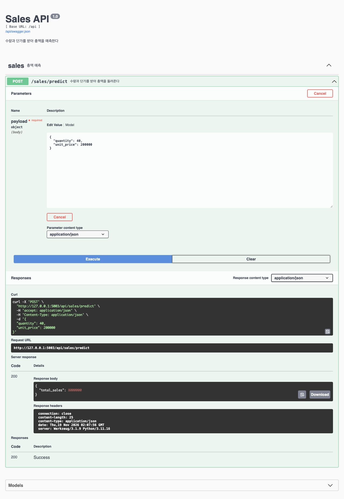

# HW6

이종석 · 21011615

## 실행 방법

Python 3.11.16, pandas 3.1.0, scikit-learn 1.9.1, joblib 1.6.0, Flask 3.1.3, flask-restx 1.3.2에서 실행했습니다. 이 폴더의 `sales_clean.csv`는 HW5에서 정리한 1,004행 데이터입니다.

저장소 루트에서 가상환경을 준비합니다.

```bash
python3 -m venv .venv
source .venv/bin/activate
python -m pip install pandas==3.1.0 scikit-learn==1.9.1 joblib==1.6.0 Flask==3.1.3 flask-restx==1.3.2 jupyterlab
python -m ipykernel install --user --name data-analysis --display-name "Python (data_analysis)"
cd HW6
jupyter lab hw6.ipynb
```

`Python (data_analysis)` 커널에서 **Restart Kernel and Run All Cells**를 실행하고 저장합니다. 마지막 코드 셀이 같은 폴더에 `sales_model.pkl`을 생성합니다. 실행 출력과 단계 ③·⑤·⑦의 답을 노트북에 포함했습니다.

가상환경이 활성화된 새 터미널에서 `HW6` 폴더로 이동해 서버를 실행합니다.

```bash
flask --app app run --host 127.0.0.1 --port 5003
```

[Swagger UI](http://127.0.0.1:5003/api/docs)에서 `POST /sales/predict`를 펼치고 **Try it out → Execute**를 누릅니다. 수량 `40`, 단가 `200000`의 응답은 `{"total_sales": 8000000}`입니다. `docs.png`는 이 요청을 실제 실행해 응답 본문을 확인한 화면입니다.

## 단계 ①·② 실행 결과

학습 데이터 803개, 테스트 데이터 201개로 나눴습니다. 입력은 `quantity`, `unit_price`이며 정답은 `total_sales`입니다. `test_size=0.2`, `random_state=0`을 사용했습니다.

| 모델 | 테스트 R² |
| --- | --- |
| 선형 회귀 | 0.862 |
| 선형 회귀 + qp | 1.000 |
| 결정 트리, 깊이 제한 없음 | 0.994 |

## 단계 ③ 답

선형 회귀는 `a × quantity + b × unit_price + c` 형태로 학습하므로 수량과 단가의 곱을 그대로 표현하지 못해 R²가 0.862입니다.
입력에서 `qp = quantity × unit_price`를 만들면 `qp`의 계수 약 1, 나머지 계수와 절편 약 0으로 총액 관계를 표현할 수 있어 R²가 1.000이 됩니다.

## 단계 ⑤ 결정과 이유

| max_depth | 잎 수 | 학습 R² | 테스트 R² | 5-fold 평균 R² | 표준편차 |
| --- | --- | --- | --- | --- | --- |
| 3 | 8 | 0.876 | 0.846 | 0.845258 | 0.019086 |
| 5 | 32 | 0.972 | 0.961 | 0.960743 | 0.002673 |
| 8 | 250 | 0.998 | 0.991 | 0.991885 | 0.000397 |
| 12 | 781 | 1.000 | 0.994 | 0.994620 | 0.000522 |
| None | 800 | 1.000 | 0.994 | 0.994721 | 0.000618 |

깊이 **8**을 선택했습니다. 교차검증 평균은 깊이 12와 약 0.0027 차이지만 잎 수는 250개로 781개보다 적어 비슷한 성능을 더 적은 분기로 얻습니다. 전체 데이터에서 `cross_val_score(..., cv=5)`를 사용했습니다.

깊이 제한이 없을 때 학습 R² 1.000과 테스트 R² 0.994의 차이가 작은 것은 이 데이터의 총액에 수량 × 단가라는 일정한 관계가 있기 때문입니다. 표는 현재 파일과 환경의 실제 실행값이며, 교안의 제한 없는 트리 교차검증 예시 0.994와 달리 현재 실행은 소수 셋째 자리 반올림 시 0.995입니다.

## 단계 ⑦ 답

API에 사용할 모델은 **선형 회귀 + qp**로 선택했습니다. 수량 40·단가 200,000원에서 선형 회귀 + qp는 **8,000,000원**, 깊이 8 트리는 반올림하면 **7,362,301원**, 실제 수량 × 단가는 **8,000,000원**입니다.
선형 회귀 + qp는 테스트 R²가 1.000이고 예시의 곱도 재현하므로 선택했습니다. 서버에서도 `quantity`, `unit_price`, `qp` 순서로 입력을 만들어 학습 때와 같은 특징을 전달합니다.

이 문제의 총액 공식이 확정된 실제 서비스에서는 직접 곱셈할 수도 있습니다. 이 과제에서는 학습·저장·API 예측 과정을 확인하기 위해 선형 회귀 + qp 모델을 사용했습니다.

## Swagger 실행 화면


